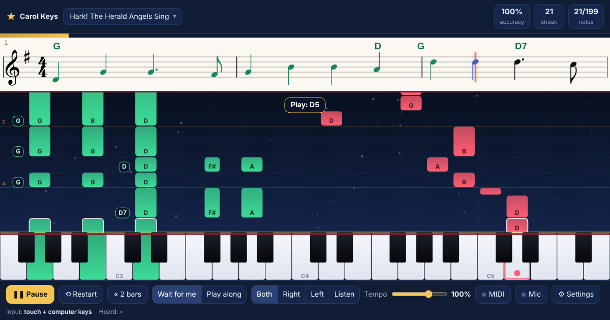

# Carol Keys

A piano practice page for Christmas carols: the melody in the right hand, chord names in the left. Live at **https://robertpiazza.com/piano/**.



## What it does

- **Falling notes** onto an on-screen keyboard. Right hand in red, left-hand chords in green with the chord name beside each block.
- **Sheet music** above the notes: the melody on a treble staff with key and time signature and the chord name above each change. A cursor follows the music, notes turn blue when they're due, green when hit and red when missed. Tap a bar to jump there.
- **Wait for me** stops until you play the right notes and shows what to play ("Play: E5 · C chord (C3 E3 G3)"). **Play along** keeps time and grades each note Perfect, Good or Miss.
- Practise both hands, either hand alone (the app plays the other), or listen.
- Tempo, metronome, back two bars, and best scores saved per song, hand and mode.
- Left-hand chords as triads, full 7th chords, root and fifth, or root only.

## Input

- **MIDI keyboard** (USB) through Web MIDI. Chrome or Edge on a computer or Android; Safari and iPad browsers don't support Web MIDI.
- **Microphone** for an acoustic piano. Basic: an FFT with harmonic summing finds pitches, a short-window loudness jump marks new notes, and notes the song expects next are accepted on weaker evidence. Headphones help so it doesn't hear its own accompaniment.
- **Touch** on the on-screen keys, or the **computer keyboard**: Z to / for the left hand (G2–B3), Q to ] for the right (C4–G5), Shift for an octave up, Space to play and pause.

## Library

18 public-domain songs: Jingle Bells (easy chorus and full), Silent Night, Joy to the World, Deck the Halls, We Wish You a Merry Christmas, Hark! The Herald Angels Sing, O Come All Ye Faithful, The First Noel, O Little Town of Bethlehem, Away in a Manger, Angels We Have Heard on High, God Rest Ye Merry Gentlemen, What Child Is This?, We Three Kings, It Came Upon the Midnight Clear, O Come O Come Emmanuel and Good King Wenceslas.

The hymn melodies and chords were converted from four-part hymnal scores (see `tools/hymns/`). You can add your own songs by loading a MIDI file or typing them in the built-in editor:

```
title: Ode to Joy
bpm: 100
time: 4/4
key: C
right: E4:1 E4 F4 G4 | G4 F4 E4 D4 | C4 C4 D4 E4 | E4:1.5 D4:.5 D4:2
left: C | G:2 C:2 | F:2 C:2 | G
```

## Development

```
npm install      # VexFlow, used for the sheet music
npm test         # checks every song's bars, the parsers and the MIDI reader
npm start        # builds to _site/ and serves it on http://localhost:8080
```

`src/index.html` is the whole app. `npm run build` inlines VexFlow into it and copies `public/` (favicon and link-preview image) to `_site/`, so the built page is one file that also works offline when opened directly in Chrome or Edge.

## Deploying

Pushing to `main` runs the tests, builds the site and publishes `_site/` to the `gh-pages` branch (`.github/workflows/deploy.yml`). In the repository settings, set **Pages → Build and deployment → Source** to **Deploy from a branch**, branch `gh-pages`, folder `/ (root)`. Because `robertpiazza.github.io` has the custom domain `robertpiazza.com`, this repository is served at `https://robertpiazza.com/piano/`.

## Third-party code

- [VexFlow](https://github.com/0xfe/vexflow) 4.2.5, MIT, for the sheet music.
- Hymn scores from [Musicam Ecclesiae](https://github.com/magdalenesacredmusic/English-Hymns) and [Ben Kuhn](https://github.com/benkuhn/carols); the music is public domain.
